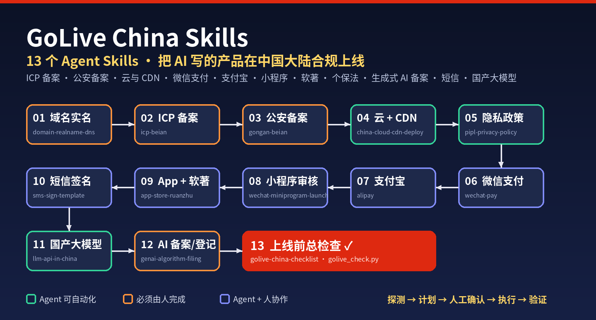
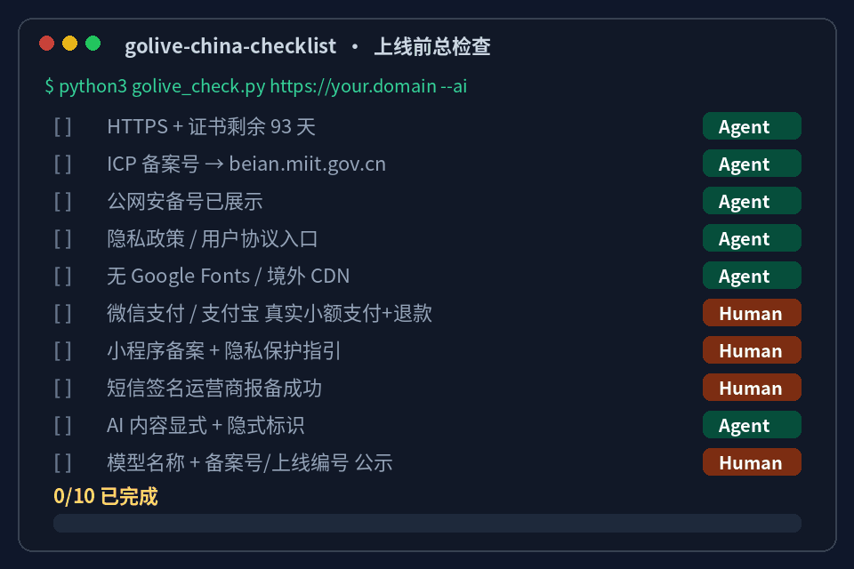
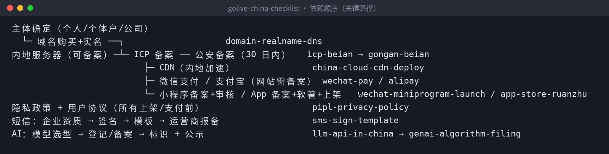
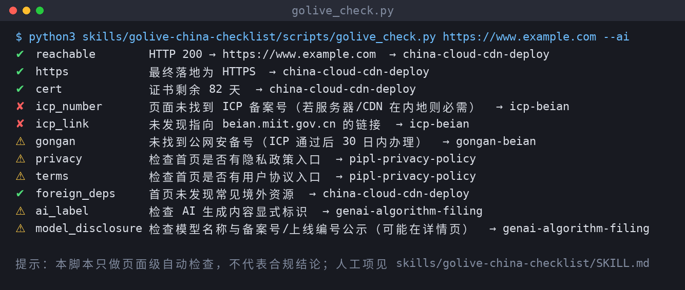
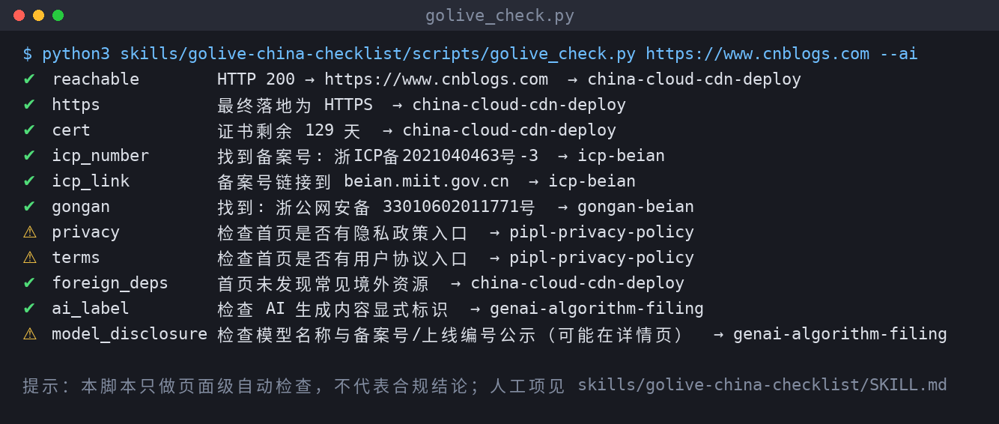

> 在线阅读（GitHub Pages）：https://maynor996.github.io/icp-agent-skills/

# 代码AI一下午写完，上线却卡在备案？开源13个Agent Skills：ICP备案、微信支付、小程序、生成式AI备案全流程

## 代码AI一下午写完，上线却卡在备案？开源13个Agent Skills：ICP备案、微信支付、小程序、生成式AI备案全流程

> 一句话介绍：**golive-china-skills** 是一套开源的 Agent Skills，让 Claude Code / Codex / Cursor 陪你把产品在中国大陆合规上线。能自动做的（改 footer、写支付回调验签、扫描隐私收集行为、起草隐私政策、跑体检脚本）Agent 直接做；必须由你本人做的（实名、人脸核验、接初审电话、短信核验、签约、提交表单）它列清楚、按顺序提醒你。
> 
> 仓库地址：https://github.com/xianyu110/golive-china-skills （MIT 协议）
> 
> ⚠️ **先声明：本文和仓库都不是法律意见。** 内容是开发者经验与公开官方资料的整理，政策、平台规则、费率与审核尺度随时变化，各地执行口径也可能不同；上线前请以官方最新页面为准，涉及经营许可、支付、未成年人、跨境数据、生成式 AI 的事项请咨询专业律师或主管部门。

### 一、痛点：最后一公里，比写代码还长

现在用 AI 编程，一个下午把产品写完不稀奇。但如果要在国内上线，后面还有一长串事情：

  * **ICP 备案、公安备案、域名实名** ：材料、顺序、短信核验时限，哪一步漏了都得重来。
  * **内地服务器和 CDN** ：CDN 要在备案后才能加，Google Fonts、境外统计脚本这类依赖还会拖慢首屏。
  * **微信支付、支付宝** ：网站场景要求域名已备案；个人主体在支付、小程序支付、短信签名等环节会受限。
  * **小程序审核、App 备案、软著、隐私政策、短信签名** ……
  * **做 AI 产品的还有一关** ：生成式 AI 备案/登记、AI 生成内容标识、模型名称与备案号公示。

网上的“备案攻略”很多，但大多是一篇长文，不会帮你改代码，也很少告诉你每一条规则出自哪个官方页面。这就是做这个仓库的原因。

### 二、项目是什么

13 个可单独安装的 Skill，Agent 按 **探测 → 计划 → 人工确认 → 执行 → 验证** 的顺序工作。和普通攻略的区别：

特点| 说明  
---|---  
📎 每条规则附官方来源| 工信部、公安部、网信办、人大网、微信支付商户平台、支付宝开放平台、微信开放文档、阿里云/腾讯云文档；核对日期 2026-10-04  
🤝 Agent / 人 分工表| 每个 skill 都写明“Agent 能自动化 vs 人必须做”，Agent 不代替你实名、签约或提交政府表单，不保管你的密钥  
🚫 常见驳回原因 + 修复| 备案、支付签约、小程序审核、短信签名、商店上架的高频驳回点  
🔗 依赖顺序| 主体一致性放第一位：域名实名主体 = 备案主体 = 商户主体 = 小程序主体 = 短信资质主体  
🛠 只读体检脚本| `golive_check.py` 检查 HTTPS、ICP/公安备案号、隐私政策入口、境外依赖、AI 标识  
⚖️ 保守| 不编造费用和时效，只引用官方页面写明的数字，不确定处明确标 ⚠️  
  

### 三、技能清单（13 个）

#| Skill| 说明  
---|---|---  
1| `icp-beian`| ICP 备案：是否需要、经营性许可 vs 非经营性备案、材料、短信核验、备案号展示  
2| `gongan-beian`| 公安联网备案：30 日内办理、填报项、公网安备号展示  
3| `domain-realname-dns`| 域名实名与解析：可备案后缀、实名主体一致、DNS/HTTPS  
4| `china-cloud-cdn-deploy`| 国内云服务器与 CDN：可备案服务器、CDN 与备案、境外依赖替换  
5| `wechat-pay`| 微信支付 APIv3：入驻材料、产品选择、回调验签解密、幂等对账  
6| `alipay`| 支付宝：签约条件、加签、异步通知验签返回 success  
7| `wechat-miniprogram-launch`| 微信小程序：小程序备案、隐私保护指引、对照官方拒绝情形自查  
8| `app-store-ruanzhu`| 应用商店与软著：App 备案、iOS ICP 号、安卓商店版权证明、软著材料  
9| `pipl-privacy-policy`| 个保法隐私政策与用户协议：代码扫描数据清单、单独同意、注销（附模板）  
10| `genai-algorithm-filing`| 生成式 AI 备案/登记/算法备案、AI 内容标识、拟人化互动新规  
11| `sms-sign-template`| 短信签名与模板：签名来源、模板写法、商业短信同意与退订  
12| `llm-api-in-china`| 国内调用大模型：已备案国产模型 vs API 中转的合规取舍  
13| `golive-china-checklist`| 上线前总检查清单 + 总调度 + 体检脚本  
  
每个 `SKILL.md` 都包含：前置条件、分步流程、检查清单、常见驳回原因与修复、Agent vs 人分工、官方来源链接、免责声明。

### 四、安装
    
    
    # 一行安装（skills CLI）
    npx skills add xianyu110/golive-china-skills
    

或者手动复制：
    
    
    git clone https://github.com/xianyu110/golive-china-skills.git && cd golive-china-skills
    mkdir -p ~/.claude/skills && cp -r skills/* ~/.claude/skills/   # Claude Code（或项目内 .claude/skills/）
    mkdir -p ~/.codex/skills  && cp -r skills/* ~/.codex/skills/    # Codex
    mkdir -p .cursor/skills   && cp -r skills/* .cursor/skills/     # Cursor（项目内）
    

Claude Code 插件市场：`/plugin marketplace add xianyu110/golive-china-skills`。只想要某一个，例如 `cp -r skills/icp-beian ~/.claude/skills/`。

### 五、实战：拿一个项目走一遍上线检查

#### Step 1：先让 Agent 出计划，明确不让它替你提交
    
    
    用 golive-china-checklist 看一下这个仓库要在国内上线还差什么，先给我计划，不要替我提交任何东西
    

Agent 会先探测：产品形态（网站/H5/小程序/App）、服务器与 CDN 在哪、是否收款、是否发短信、是否收集个人信息、是否有 AI 生成功能、是否有 UGC。然后输出一张带依赖关系的计划表，每行标 Owner = Agent / Human / Both，没确定的标 ❓。

skill 里的关键路径长这样：

#### Step 2：跑只读体检脚本

脚本只用 Python 标准库，**只读、不提交任何表单** ：
    
    
    python3 skills/golive-china-checklist/scripts/golive_check.py https://你的域名 --ai
    python3 skills/golive-china-checklist/scripts/golive_check.py https://你的域名 --json > golive-report.json
    

我拿两个公开网站实际跑了一下做对比。先是一个典型的境外站点 `example.com`：HTTPS 没问题，但页面上没有 ICP 备案号和 beian.miit.gov.cn 链接（对境外站点这是正常的，脚本也提示了“若服务器/CDN 在内地则必需”）：

再看一个国内已备案的站点（博客园首页），ICP 备案号、备案号链接、公网安备号都能识别出来：

注意两点：一是隐私政策、用户协议、模型公示这类项目可能放在子页面，脚本只看首页，所以给的是 ⚠️ 提醒而不是结论；二是脚本自己也写明了——**结果只是页面级自动检查，不代表合规结论** ，人工项要对照 SKILL.md。

#### Step 3：Agent 能直接改代码的部分——以 ICP 和微信支付为例

ICP 备案通过后，Agent 可以直接改 footer：
    
    
    <a href="https://beian.miit.gov.cn/" target="_blank" rel="noreferrer">京ICP备XXXXXXXX号-1</a>
    

而人必须做的部分，`icp-beian` 会按顺序列出来：人脸核验、拍摄证件原件、接云厂商初审电话、提交管局后收到 12381 短信须在 **24 小时内** 完成核验（逾期需重新提交），以及网站开通后 30 日内办理公安联网备案（公安部令第 33 号：自网络正式联通之日起三十日内，转 `gongan-beian`）。这些时限都附了阿里云帮助中心和公安部令的原文链接。

微信支付这块，`wechat-pay` 把官方要求的回调处理顺序写成了步骤：取原始 body + `Wechatpay-*` 请求头 → SHA256-RSA 验签（序列号以 `PUB_KEY_ID_` 开头用微信支付公钥，否则用平台证书）→ 用 APIv3 密钥做 AES-256-GCM 解密 → 校验 mchid/appid/订单号/金额 → **幂等** 更新订单。skill 里附了一段 Node.js 示意（以官方文档为准）：
    
    
    // Node.js 18+ 回调验签与解密示意（节选自 wechat-pay/SKILL.md）
    import crypto from "node:crypto";
    export function verifyAndDecrypt({ headers, rawBody, wechatpayPublicKeyPem, apiV3Key }) {
      const msg = `${headers["wechatpay-timestamp"]}\n${headers["wechatpay-nonce"]}\n${rawBody}\n`;
      const ok = crypto.verify("RSA-SHA256", Buffer.from(msg), wechatpayPublicKeyPem,
                               Buffer.from(headers["wechatpay-signature"], "base64"));
      if (!ok) throw new Error("bad signature");
      const { resource } = JSON.parse(rawBody);
      const buf = Buffer.from(resource.ciphertext, "base64");
      const decipher = crypto.createDecipheriv("aes-256-gcm", Buffer.from(apiV3Key), Buffer.from(resource.nonce));
      decipher.setAuthTag(buf.subarray(buf.length - 16));
      decipher.setAAD(Buffer.from(resource.associated_data || ""));
      return JSON.parse(Buffer.concat([decipher.update(buf.subarray(0, buf.length - 16)), decipher.final()]).toString());
    }
    

最常见的坑也在检查清单里：**验签要用原始 body，不要先`JSON.parse` 再 `stringify`**；金额以“分”为单位并与本地订单比对；密钥和证书只放服务端。费用方面，skill 只引用微信支付页面原文（申请接入不收申请费；交易服务费率与经营类目有关），具体以你签约类目的页面为准。

#### Step 4：做 AI 产品的，单独过一遍 AI 合规
    
    
    用 genai-algorithm-filing 判断我的 AI 小程序走备案还是登记
    

skill 会按判断树给出倾向：自研/微调模型对外提供生成服务 → 大模型备案路径；仅通过 API 调用已备案模型 → 属地网信办登记路径；调用未备案或境外模型给境内公众提供服务 → ⚠️ 高风险。无论哪条路，**AI 生成内容的显式 + 隐式标识** 都要做，并在产品页公示模型名称与备案号/上线编号。最终路径由你和属地网信办/律师确认，skill 只给倾向，不下结论。

### 六、进阶技巧

**1\. 隐私政策从代码里“长”出来**
    
    
    用 pipl-privacy-policy 扫描代码，生成隐私政策和第三方 SDK 清单
    

Agent 会扫描注册表单、手机号验证码、日志里的 IP/UA、埋点和统计 SDK、崩溃上报，以及**发给大模型的用户输入** ，生成 `data-inventory.md`，再按个保法第十七条的告知要求起草政策，标出需要“单独同意”的项（如向第三方提供、敏感个人信息、出境）。发布前仍需律师审阅。

**2\. 开发和生产的模型配置分开**

`llm-api-in-china` 的建议是：`LLM_BASE_URL / LLM_API_KEY / LLM_MODEL` 走环境变量，开发和生产用不同配置，**生产只允许已备案模型白名单** 。多数国产模型提供 OpenAI 兼容接口，代码只需换 base_url。

**3\. 上线当天的最后四件事**

体检脚本全部 ✅ 或已解释的 ⚠️；真实小额支付 + 退款走通；内地多地区拨测首屏；客服与投诉渠道可用。

### 七、开发时没有 Claude / API？

写这些代码时你可能需要一个能用的模型。下面是作者团队推荐的**开发者工具** （含推广链接），用于你本人写代码、做原型——**不是** 面向中国境内用户的生产合规方案：

  * **方法一 · Claude 国内镜像站** ：`https://claude-opus.top/` —— 浏览器里直接辅助编程
  * **方法二 · 一站式 API** ：`https://tryallapi.com/register?aff=5A6A` —— OpenAI 兼容，本地开发时一个 Key 切换多家模型

产品上线后，生产环境请切换到已备案的国产模型，并按 `genai-algorithm-filing` 完成登记/备案。也请勿向任何第三方开发工具输入真实用户个人信息、密钥或保密代码，使用前阅读其条款并自行评估数据出境风险。

### 八、写在最后

这个仓库想做的，是把“上线前要问十个人、翻二十个页面”的事情，变成 Agent 能读懂、能执行、能检查的流程，同时**把边界写清楚** ：Agent 写代码、写文档、跑检查；实名、签约、提交和承担主体责任的，始终是你自己。

再强调一次：本文不是法律意见，规则以官方最新页面为准。发现过时或错误的地方，欢迎提 Issue / PR 并附上官方链接。

如果它帮你少走了弯路，欢迎点个 ⭐ Star：

👉 **https://github.com/xianyu110/golive-china-skills**

**其他开源仓库：**

  * 电商出图 Skills（白底主图 / A+ / 小红书封面 / 详情长图）：https://github.com/xianyu110/ecommerce-image-skills
  * 电商短视频 Skills（商品图 → 带配音字幕的 9:16 视频）：https://github.com/xianyu110/ecommerce-video-skills
  * 品牌 IP 视觉套件 Skills（IP 形象 · Logo · VI · 包装 · 表情包）：https://github.com/xianyu110/brand-ip-kit-skills

* * *

我是 MaynorAI 团队，分享 AI 编程、AI SaaS 工具出海、一人团队搭建经验。